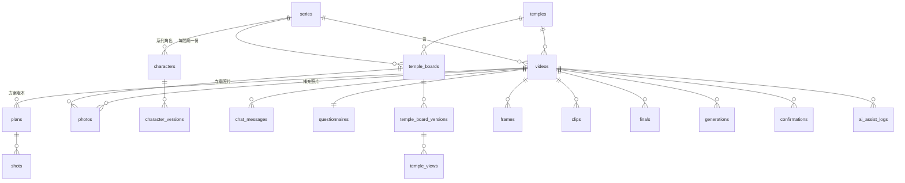

# 05 Backend Schema：資料怎樣存

廟埕影室（Templeyard Studio）· 2026-11-02

資料庫：SQLite（Drizzle ORM）。檔案存在 `data/assets/`，資料庫只存路徑。主鍵一律 UUID 字串；時間以 ISO 8601 字串存放；JSON 欄位以 Zod schema 驗證後寫入。

## 登入流程

第一版**不做登入**：個人在本機使用，開啟網頁就進入系列首頁，不區分使用者。後端只監聽 `127.0.0.1`。之後若要對外開放，再加使用者資料表與每張表的 `owner_id`。

## 關聯總覽

## 資料表

### `series` 系列專案

| 欄位 | 型別 | 說明 |
| --- | --- | --- |
| id | text PK | |
| name | text | 系列名稱 |
| visual_style | text | 整體視覺風格 |
| direction | text | 歷史故事／節慶宣傳／景點導覽／人物代言／自訂 |
| default_image_model | text | 預設圖片模型 |
| default_video_model | text | 預設影片模型 |
| questionnaire_defaults | json | 問卷預設值（來自第一支影片），可修改 |
| created_at, updated_at | text | |

### `temples` 寺廟（只讀）

由 `data/temples.csv` 匯入，執行期間不寫入。

| 欄位 | 型別 | 說明 |
| --- | --- | --- |
| id | text PK | 原始 UUID |
| name | text | 登記名稱（原文） |
| name_normalized | text | 搜尋用：「臺」轉「台」、去掉「財團法人新北市」前綴 |
| flags | json | 財團法人、已廢止、未取得登記證、重名 |
| status | text | active／abolished／unregistered |
| district, village, address | text | 行政區、里（缺漏時從地址補）、地址 |
| phone, phone_raw | text | 正規化電話、原始值 |
| deity, religion | text | 主祀神明、教別 |
| founded_year, founded_raw | integer, text | 創建年（西元，無法判斷為 null）、原始紀年 |
| rebuilt_year, rebuilt_raw | integer, text | 重建年、原始紀年 |

索引：`name_normalized`、`district`、`deity`。搜尋預設只回傳 `status = active`。

### `characters`、`character_versions` 角色與版本

| 表 | 欄位 | 說明 |
| --- | --- | --- |
| characters | id, series_id (nullable), video_id (nullable), name, is_series, current_version_id | 系列角色有 series_id；影片專屬角色有 video_id。系列設定的角色庫建立的角色：series_id 有值、video_id 為 null、is_series = 1 |
| character_versions | id, character_id, version, description, identity_anchors (text nullable), look (text nullable), change_note (text nullable), continuity_locks (json：字串陣列), sheet_asset_id, look_asset_id, image_model, confirmed_at | 確認後鎖定，後續生成都使用此版本。identity_anchors、look 由角色詳情分開編輯，description 由兩者組成；change_note 說明和上一版的差別 |

### `temple_boards`、`temple_board_versions`、`temple_views` 寺廟定裝版

| 表 | 欄位 | 說明 |
| --- | --- | --- |
| temple_boards | id, series_id, temple_id, current_version_id | 唯一鍵 (series_id, temple_id)：同系列同一間廟只有一份 |
| temple_board_versions | id, board_id, version, image_model, appearance_locks (json), default_lighting, confirmed_at | 另存新版本時新增一列 |
| temple_views | id, board_version_id, view_key, view_name, source (photo／ai_inferred), photo_id (nullable), asset_id, confirmed, created_from_video_id | 補充視角也是一列 |

`view_key` 例：`front_overview`、`sanchuan_hall`、`main_hall`、`courtyard`、`detail_roof`、`custom_*`（標準清單待決定）。

### `photos` 照片

| 欄位 | 型別 | 說明 |
| --- | --- | --- |
| id | text PK | |
| series_id, temple_id | text | 寺廟照片：屬於系列中的這間廟 |
| video_id | text nullable | 有值代表第 3 步的補充照片，只屬於該影片 |
| original_asset_id | text | 原圖，只存本機，永不送往雲端 |
| deidentified_asset_id | text | 去識別後的圖 |
| view_key | text nullable | 判讀出的視角 |
| deid_boxes | json | 遮蔽框（自動／手動、是否被取消） |
| created_at | text | |

### `videos` 影片

| 欄位 | 型別 | 說明 |
| --- | --- | --- |
| id | text PK | |
| series_id, temple_id | text | |
| stage | text | creating／board_pending／chat／questionnaire／plan／frames_generating／frames／video_generating／final／done |
| image_model, video_model | text | 選定的模型 |
| models_locked_at | text nullable | 產生寺廟定裝版時寫入；有值後兩個模型欄位不可更新（後端強制） |
| temple_board_version_id | text | 這支影片使用的定裝版版本 |
| one_pass | integer (0/1) | 一次到底 |
| user_temple_notes | text | 使用者貼上的寺廟歷史與簡介 |
| creative_input | text | 第 3 步的第一句話 |
| cost_limit | integer nullable | 本支影片費用上限（以點數或最小貨幣單位） |
| copied_from_video_id | text nullable | 複製來源 |
| series_snapshot | json | 建立影片時保存的系列設定：視覺風格、方向、預設模型、問卷預設值；之後這支影片的生成讀這份，不讀系列的即時值（落實「修改只影響之後新增的影片」） |
| created_at, updated_at | text | |

### `chat_messages` 對話紀錄

| 欄位 | 說明 |
| --- | --- |
| id, video_id | |
| scope | video／shot |
| shot_key | scope 為 shot 時，指向那一格 |
| role | user／agent |
| content | 文字 |
| tool_calls | json：Agent 執行的操作與結果摘要 |
| created_at | |

### `questionnaires` 問卷

| 欄位 | 說明 |
| --- | --- |
| id, video_id | 一支影片一份 |
| answers | json：每題 `{ questionId, choice?, custom?, source: user／series_default／system, systemReason? }` |
| submitted_at | 送出時間 |

送出時若系列 `questionnaire_defaults` 為空，以這份答案（排除每支影片不同的題目）寫入。

### `ai_assist_logs` AI 輔助撰寫紀錄

| 欄位 | 說明 |
| --- | --- |
| id, series_id, video_id (nullable) | 第 1 步的紀錄只有 series_id |
| field | 欄位代號，例如 `questionnaire.goal`、`shot.dialogue` |
| user_input | 使用者原本的輸入 |
| suggestion | AI 建議 |
| adopted | 是否採用 |
| created_at | |

### `plans`、`shots` 分鏡方案與卡片

| 表 | 欄位 | 說明 |
| --- | --- | --- |
| plans | id, video_id, version, style_note, source (agent／user_edit／chat_edit／revert), diff (json), created_at | 每次修改新增一列；最新版為現行方案 |
| shots | id, plan_id, shot_key, seq, start_sec, duration_sec, shot_size, camera_move, camera_speed, camera_angle, description, action_start, action_end, view_key, lighting, character_ids (json), dialogue, speaker, subtitle, photo_id, keyframes_enabled, keyframe_times (json), custom_prompt, fact_sources (json), dialogue_estimate_sec, native_voice (nullable), candidate_count (nullable) | 一列是某一版方案中的一格；`native_voice`、`candidate_count` 是細修頁的生成設定，null 表示沒設定過（使用原生語音、1 張候選圖） |

`shot_key` 是跨版本不變的格子識別碼：同一格在不同方案版本有相同的 `shot_key`，生成的圖與影片都掛在 `shot_key` 上，因此改版本不會遺失已生成的內容。

### `frames` 精緻圖與關鍵畫格

| 欄位 | 說明 |
| --- | --- |
| id, video_id, shot_key | |
| kind | first／last／keyframe |
| at_sec | 關鍵畫格的時間點 |
| asset_id | |
| generation_id | 產生它的生成紀錄；使用者上傳時為 null |
| user_uploaded | 是否為使用者上傳（已去識別） |
| edit_of_frame_id | 限定範圍修改的來源圖 |
| selected | 是否為選定圖 |
| based_on | json：產生時依據的方案版本、角色版本、定裝版版本（用來判斷失效） |
| needs_reconfirm | 是否需重新確認 |

### `clips`、`finals` 影片片段與成品

| 表 | 欄位 | 說明 |
| --- | --- | --- |
| clips | id, video_id, shot_key, asset_id, generation_id, selected, keyframe_similarity (json), based_on (json), needs_reconfirm | 每格的影片片段；`based_on.revision` 記對話修改成品時排定的調整指令 |
| finals | id, video_id, asset_id, clip_ids (json), subtitle_asset_id, created_at | 合成後的成品；「需重新確認」不另存欄位：用的影片不是各格目前的影片、或任一格影片需重新確認時就是 |

### `assets` 檔案

| 欄位 | 說明 |
| --- | --- |
| id | |
| kind | original_photo／deid_photo／view／character_sheet／frame／clip／final／subtitle／audio（參考圖拼接圖存成 frame） |
| path | `data/assets/` 下的相對路徑 |
| mime, width, height, duration_sec, sha256 | |
| cloud_ok | 是否允許送往雲端（original_photo 永遠為 0） |

### `generations` 生成紀錄

| 欄位 | 說明 |
| --- | --- |
| id, video_id (nullable) | 第 1 步的 AI 輔助撰寫沒有 video_id |
| node | 節點代號，例如 `temple-view`、`refined-frame`、`shot-video`、`agent` |
| target | json：對象，例如 `{ shotKey, kind }` |
| prompt_id_ref, prompt_version | 使用的生成指令與版本 |
| mcp_tool | `partner_generate`／`run_template`（Claude 呼叫為 `claude`） |
| model | 模型代號或範本名稱，例如 `vertexai/nano-banana-pro`、`api_google_gemini_omni_flash_1_1_t2v` |
| call_config_version | `workflows/` 中呼叫設定的版本 |
| provider_task_id | Comfy Cloud 的 `prompt_id`（Claude 呼叫為訊息 ID） |
| confirm_required, confirm_message | 雲端是否要求確認、雲端回的確認文字 |
| status | awaiting_confirm／submitted／running／succeeded／failed／timeout |
| input | json：組裝後的指令與參數（不含金鑰） |
| user_instruction | 使用者的修改指令 |
| estimated_cost, reserved_cost, actual_cost | 費用 |
| error | 失敗原因 |
| created_at, finished_at | |

索引：`(status)` 供啟動時的中斷恢復查詢。

### `confirmations` 確認紀錄

| 欄位 | 說明 |
| --- | --- |
| id, video_id | |
| point | temple_board／questionnaire／plan_generate／frames／final |
| content_ref | json：確認時的內容版本（方案版本、定裝版版本等） |
| confirmed_at | |
| invalidated_at | 因上游修改而失效的時間；不刪除 |

### `settings` 系統設定

| 欄位 | 說明 |
| --- | --- |
| key, value | 例如單筆同意門檻、Comfy Cloud 方案、各模型參考單價 |

## 後端強制的規則

- `videos.models_locked_at` 有值後，拒絕更新 `image_model`、`video_model`。
- 任何送往 Comfy Cloud 的檔案，必須是 `assets.cloud_ok = 1` 的資產。
- 付費生成前檢查 `cost_limit` 與單筆門檻，超過時回傳「需要同意」，不送出。
- 系列角色庫的生成不屬於任何影片（`generations.video_id` 為 null）：沒有影片上限，只套用單筆門檻；同意憑證綁定系列（使用者 2026-11-05 提出）。
- `temples` 只讀；Agent 沒有寫入寺廟資料的端點。
- 刪除一律軟刪除或改為「被取代」，版本與確認紀錄不刪除。

## 主要 API（REST，JSON）

生成類的 POST 沒有同意憑證時回 409，附上預估與原因（`message: 這次生成需要先同意費用`、`check`）。

| 方法與路徑 | 用途 |
| --- | --- |
| `GET /api/health` | 健康檢查 |
| `GET/POST /api/series`、`PATCH /api/series/:id` | 系列 |
| `GET /api/series/:id/videos?status=&sort=`（status：all、wip、done；sort：updated、created、temple） | 過去的影片：寺廟、階段與狀態細節、鎖定的模型、更新時間、縮圖、成品長度、是否為問卷預設來源 |
| `GET/PATCH /api/series/:id/questionnaire-defaults` | 系列問卷預設值：逐題修改或清除，回傳來源影片 |
| `GET /api/characters/:cid/versions`、`GET /api/characters/:cid/usage` | 角色詳情：版本列表；用到這個角色的影片與版本 |
| `GET/POST /api/series/:id/characters?scope=&q=`（scope：all、series、video） | 角色庫：列出系列角色與這個系列影片的影片專屬角色（可搜尋、篩選）、新增系列角色 |
| `POST /api/series/:id/cost-estimate`、`POST /api/series/:id/consents` | 角色庫生成的費用預估、取得同意憑證（綁定系列） |
| `GET/PATCH /api/settings` | 系統設定（單筆同意門檻） |
| `GET /api/temples?q=` | 寺廟搜尋 |
| `POST /api/videos`、`GET/PATCH /api/videos/:id` | 建立影片、影片詳細資料、選模型 |
| `POST /api/videos/:id/photos/originals` | 原圖（只存本機，不會上雲） |
| `POST /api/videos/:id/photos`、`PATCH .../photos/:photoId` | 去識別後的照片、調整遮蔽 |
| `GET/PATCH /api/videos/:id/temple-board` | 定裝版、外觀規範與光線 |
| `POST /api/videos/:id/temple-board/generate`、`.../confirm`、`.../reuse`、`.../versions` | 產生、確認、沿用、另存新版本 |
| `POST /api/videos/:id/temple-board/views/:viewKey/regenerate`、`.../confirm` | 單一視角重生、確認 |
| `POST /api/videos/:id/temple-board/supplemental-views`、`.../:viewKey/confirm` | 補充視角 |
| `GET/POST /api/videos/:id/chat` | 對話紀錄、與 Agent 對話（SSE） |
| `GET/PUT /api/videos/:id/questionnaire` | 問卷 |
| `GET /api/videos/:id/plan`、`POST .../plan/generate`、`POST .../plan/versions`、`GET .../plan/versions/:version` | 方案與版本 |
| `GET /api/videos/:id/characters`、`PATCH /api/characters/:cid`、`POST /api/characters/:cid/generate`、`.../confirm`、`.../series` | 角色、定裝圖、加入系列。`generate` 的 body 有 `videoId` 時用影片的圖片模型；沒有 `videoId` 時只限系列角色，用系列的預設圖片模型 |
| `GET /api/videos/:id/frames`、`POST .../generate/frames` | 精緻圖 |
| `POST /api/videos/:id/shots/:shotKey/regenerate`、`.../frames/confirm` | 單格重生、確認這一格 |
| `GET/PATCH /api/videos/:id/shots/:shotKey` | 分鏡細修的資料、儲存這一格 |
| `POST .../shots/:shotKey/frames/upload`、`.../frames/:frameId/select`、`.../frames/:frameId/edit` | 上傳自己的首格／末格、選回、限定範圍修改 |
| `POST .../shots/:shotKey/keyframes/generate` | 產生中間關鍵畫格 |
| `GET/POST .../shots/:shotKey/chat` | 只針對這一格的對話（SSE） |
| `GET /api/videos/:id/clips`、`POST .../generate/clips` | 影片、成品與生成狀態；生成影片並合成 |
| `POST /api/videos/:id/final/confirm`、`GET .../final/download` | 確認成品（階段變為 done）、下載 MP4 |
| `POST /api/videos/:id/copy` | 複製影片 |
| `GET /api/videos/:id/cost`、`POST .../cost-estimate`、`POST .../consents` | 累計費用、預估、取得同意憑證 |
| `GET /api/videos/:id/events` | SSE：精緻圖的生成狀態 |
| `POST /api/assist`、`GET /api/assist/:id`、`POST /api/assist/:id/adopt` | AI 輔助撰寫 |
| `GET /api/assets/:id` | 讀取本機檔案 |

---

## v9 新增（想影，第 15 階段起）

依 `docs/01-PRD-第二階段改版.md`（第二階段改版，v9）的 F23～F34。這一節只列新增與修改；上面的既有資料表與 API 不變，除非下面明確寫到。

### 登入流程（取代上方「第一版不做登入」，第 19 階段起）

- 簡單帳號密碼登入，不做註冊、忘記密碼、權限；各資料表**不加** `owner_id`。
- 帳號由指令列建立：`pnpm user:create <帳號>`，互動輸入密碼。
- 密碼以 `node:crypto` 的 scrypt 雜湊（含隨機 salt），不加新的密碼套件。
- 登入後發 session cookie（`httpOnly`、`SameSite=Lax`，本機不設 `Secure`），有效 7 天。
- 除了 `GET /api/health` 與 `/api/auth/*`，所有 API 沒有有效 session 時回 401；前端除了 `/login`，所有頁面沒登入時導向 `/login?next=<原路徑>`。
- 環境變數 `AUTH_DISABLED=1` 時略過登入（第 0～18 階段的情境測試用這個設定執行）。

### 情境包設定檔（不在資料庫）

放在 `scenario-packs/<id>/pack.json`，啟動時以 `packages/shared` 的 Zod schema 驗證，失敗就啟動失敗並說明哪一欄。第一版有 `temple`、`ecommerce` 兩個。

| 欄位 | 說明 |
| --- | --- |
| id, name | `temple`／`ecommerce`；顯示名稱「廟埕」／「電商」 |
| subject_type | `temple`／`product` |
| labels | 介面用詞，例如 `{ subject: "商品", board: "商品定裝版", subjectPhotos: "商品照" }` |
| directions | 系列「方向」的選項（廟埕包沿用既有選項；電商包：新品上市、促銷活動、品牌故事、使用教學、自訂） |
| categories | 電商包的商品類別：服飾配件、3C 家電、居家生活、美妝保養、食品飲料、保健、其他；廟埕包為空陣列 |
| view_keys | 定裝版視角 `{ key, name }`。電商包：`front`、`angle_45`、`back_side`、`detail`、`package`、`in_use`；廟埕包沿用 `packages/shared/src/views.ts` |
| features | 開關：`scriptProposals`（F28）、`styleQuestion`（F29）、`productHero`（F27）。電商包全開；**廟埕包全關，維持 v8 流程** |
| script_structure | 腳本段落 `{ key, name, purpose }`。電商包：`hook` 開頭抓注意、`pain` 痛點或需求、`demo` 商品示範、`benefit` 賣點、`cta` 行動呼籲 |
| style_options | 風格 `{ key, name, prompt_fragment }`。電商包：`humor` 幽默、`exaggerated` 誇張、`realistic` 真實描述、`warm` 溫馨、`premium` 質感；另有「自己寫」 |
| default_aspect_ratio, default_duration_sec | 電商包 `9:16`、15；廟埕包 `16:9`、30 |
| subtitle_safe_area | 依比例的字幕安全區（離上下邊緣的比例），例如 9:16 下緣保留 20% |
| compliance | `blocked_terms`（依類別，命中時擋下生成）、`warn_terms`（標黃提醒）、`replacements`（建議替代說法）。廟埕包為空 |
| prompts | 節點代號 → Prompt Studio 的指令 id；電商包新增 `product-view`、`script-proposal`，其他節點可共用既有指令並帶入情境包的片段 |

### 修改的資料表

| 表 | 新增或修改的欄位 | 說明 |
| --- | --- | --- |
| series | `scenario_pack` text NOT NULL DEFAULT `'temple'` | 建立後不可更新（後端強制）；既有資料遷移為 `temple` |
| videos | `subject_type` text NOT NULL DEFAULT `'temple'` | `temple`／`product`，等於系列情境包的 subject_type |
| videos | `temple_id` 改為 nullable；新增 `product_id` text nullable | 依 subject_type 二選一有值 |
| videos | `product_snapshot` json nullable | 建立影片時保存的商品資料；之後腳本、字幕、指令都讀這份（比照 `series_snapshot`） |
| videos | `product_board_version_id` text nullable | 電商影片使用的商品定裝版版本 |
| videos | `aspect_ratio` text NOT NULL DEFAULT `'16:9'` | `16:9`／`9:16`；`models_locked_at` 有值後不可更新 |
| videos | `stage` 新增 `script` | 位於 `chat` 與 `questionnaire` 之間，只有 `features.scriptProposals` 開啟時會經過 |
| photos | `temple_id` 改為 nullable；新增 `product_id` text nullable | 商品照屬於系列中的這件商品；`video_id` 為 null 時 `temple_id`、`product_id` 恰好一個有值 |
| shots | 新增 `product_hero` integer (0/1) DEFAULT 0、`product_photo_id` text nullable | 商品主鏡頭與指定的商品照（F27）；`product_hero = 1` 時 `product_photo_id` 必填 |
| assets | `kind` 新增 `product_view`、`hero_frame` | `hero_frame`：商品照依比例置中補底後的首格（本機以 FFmpeg 產生，`cloud_ok` 繼承來源照片） |
| generations | `node` 新增 `product-view`、`script-proposal` | |
| confirmations | `point` 新增 `product_board`、`script` | |

問卷的「風格」題不改資料表：存在 `questionnaires.answers`，`questionId` 為 `style`；第一支影片送出時一併寫入 `series.questionnaire_defaults`。

### 新增的資料表

#### `products` 商品

| 欄位 | 型別 | 說明 |
| --- | --- | --- |
| id | text PK | |
| series_id | text | 只屬於一個電商系列 |
| name | text | 品名（必填） |
| brand | text nullable | 品牌 |
| category | text | 情境包 `categories` 之一（必填） |
| selling_points | json | 字串陣列，1～5 條（必填至少 1 條） |
| price | integer nullable | 新台幣元 |
| price_note | text nullable | 例如「原價 1,280，限時 990」，影片中逐字使用 |
| specs | text nullable | 規格 |
| notes | text nullable | 注意事項 |
| created_at, updated_at | text | |

#### `product_boards`、`product_board_versions`、`product_views` 商品定裝版

結構與規則比照寺廟定裝版。

| 表 | 欄位 | 說明 |
| --- | --- | --- |
| product_boards | id, series_id, product_id, current_version_id | 唯一鍵 (series_id, product_id) |
| product_board_versions | id, board_id, version, image_model, appearance_locks (json), default_lighting, confirmed_at | |
| product_views | id, board_version_id, view_key, view_name, source (photo／ai_inferred), photo_id (nullable), asset_id, confirmed, created_from_video_id | |

#### `script_proposals` 腳本企劃

| 欄位 | 說明 |
| --- | --- |
| id, video_id | |
| batch | 第幾批（從 1 開始；「再給 3 個」就加 1） |
| proposals | json：3 個 `{ title, summary, sections: [{ key, content }], fit }`，`sections` 的 key 來自情境包 `script_structure` |
| selected_index | nullable；選定第幾個（0～2） |
| custom | text nullable；使用者自己寫的方向（與 selected_index 擇一） |
| generation_id | 產生它的生成紀錄（Claude 呼叫） |
| created_at | |

#### `users`、`sessions` 帳號

| 表 | 欄位 | 說明 |
| --- | --- | --- |
| users | id, username (unique), password_hash, created_at | |
| sessions | id, user_id, expires_at, created_at | 登出時刪除該列 |

### v9 新增的後端強制規則

- `series.scenario_pack` 建立後拒絕更新。
- `videos.models_locked_at` 有值後，也拒絕更新 `aspect_ratio`。
- 影片的 `subject_type` 必須等於系列情境包的 `subject_type`；電商影片必須有 `product_id`，廟埕影片必須有 `temple_id`。
- 商品主鏡頭的首格是 `hero_frame` 資產，由商品照本機產生、不送圖片模型；它的來源照片必須是 `cloud_ok = 1` 的去識別照片。
- 價格、品名、`price_note` 只出現在合成字幕，逐字取自 `product_snapshot`；組裝圖片與影片指令時，不得要求模型畫出文字（指令組裝測試驗證）。
- 內容檢查（F31）是 `packages/shared` 的純函式：輸入文字與商品類別，回傳 `{ level: block／warn, term, field, suggestion }[]`；任何一格有 `block` 時，`POST .../generate/frames` 與 `.../generate/clips` 回 409，`message: 有不能使用的用語，請先修改`。
- 腳本企劃不觸發任何付費生成（只呼叫 Claude）。

### v9 新增的 API

| 方法與路徑 | 用途 |
| --- | --- |
| `GET /api/scenario-packs` | 列出情境包：id、名稱、labels、預設比例與長度、features |
| `GET/POST /api/series/:id/products`、`GET/PATCH /api/products/:pid` | 商品列表、新增、讀取、修改（修改只影響之後新增的影片） |
| `POST /api/products/:pid/photos/originals`、`POST /api/products/:pid/photos`、`PATCH /api/products/:pid/photos/:photoId` | 商品照原圖（只存本機）、去識別後的照片、調整遮蔽 |
| `GET/PATCH /api/videos/:id/product-board` | 商品定裝版、外觀規範與光線 |
| `POST /api/videos/:id/product-board/generate`、`.../confirm`、`.../reuse`、`.../versions` | 產生、確認、沿用、另存新版本 |
| `POST /api/videos/:id/product-board/views/:viewKey/regenerate`、`.../confirm` | 單一視角重生、確認 |
| `GET /api/videos/:id/script-proposals`、`POST /api/videos/:id/script-proposals` | 列出各批企劃；產生新一批 3 個 |
| `POST /api/videos/:id/script-proposals/:batch/select` | body `{ index }` 或 `{ custom }`；寫入確認紀錄 `script`，影片階段進到 `questionnaire` |
| `POST /api/compliance/check` | body `{ category, fields: { [field]: text } }`，回傳問題清單（前端即時檢查用） |
| `POST /api/auth/login`、`POST /api/auth/logout`、`GET /api/auth/me` | 登入、登出、目前使用者 |
